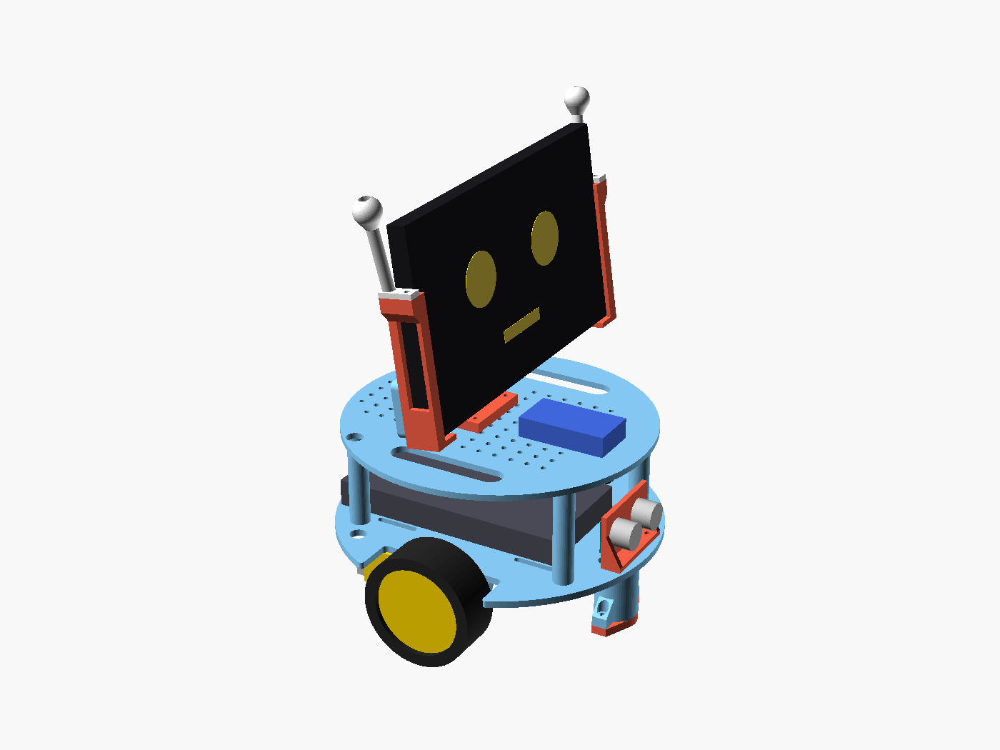

# Kıpır v1: kendi ev robotumuz



Kıpır, yüzü bir telefon ya da eski bir tablet olan, ~23 cm boyunda, 2 tekerlekli bir ev robotu.
Aklı iki katlı: **ESP32** motorları, sensörü ve güvenliği yönetir; **telefon** görür,
duyar, konuşur ve Claude ile düşünür. Gövde 3D baskı (~281 g), elektronik ~1.480 TL,
toplam **~2.600-3.900 TL**.

Elimizdeki cihazların hepsi işe yarıyor:

| Cihaz | Kıpır'daki görevi |
|---|---|
| Telefonun | Kafa: yüz + ön kamera + mikrofon + hoparlör + yapay zekâ (`web/beyin.html`) |
| Galaxy Tab 3 Lite (SM-T110) | Büyük yüz ekranı (`/yuz`) ya da dokunmatik kumanda (`/`) |
| Powerbank | ESP32'yi ve tableti besler |
| Kumandalı RGB gece lambası | Kumandası robotun IR kumandası olur (tuşlar öğretilebilir); LED'leri gövde ışığı |
| Gamebox kolu | Kablolu NES tipi kolsa ESP32'ye bağlanır (`USE_NES_PAD`); 2,4 GHz USB alıcılıysa telefon beyni sayfasında gamepad olur |
| Corby drone | Pili ve (RTSP çalışırsa) kamerası yedek parça; motorları teker için uygun değil |

## Klasörler

```
robot/
├── docs/
│   ├── ARASTIRMA.md   PhoneBot, OpenBot, Hugging Face/LeRobot, RTX Spark vs DGX Spark, kaynaklar
│   ├── MALZEME.md     parça listesi, Türkiye fiyatları, toplam maliyet
│   ├── BASKI.md       3D baskı ayarları, stüdyoya gidecek hazır mesaj, fiyat tahmini
│   ├── MONTAJ.md      adım adım montaj, bağlantı tablosu, ilk çalıştırma
│   ├── BUTCE.md       bütçeye göre 5 kademe (görselli): sade, v1, göz, ses, öğrenen kol
│   ├── HAZIR_ROBOTLAR.md  hazır robotlar (Microduck, Bittle, Loona...) ve Türkiye'ye gelmiş fiyatları
│   ├── MINI.md        5-10 bin TL'ye masaüstü robot: Kıpır Mini 4 / Mini 2 / Küp
│   ├── YENI_NESIL.md  Sesame'den daha tatlı dört masa robotu, jüri kararı ve gerçek maliyetler
│   ├── SESAME_STACKCHAN.md  Sesame ve StackChan ile karşılaştırma, Türkiye'de gerçek fiyatları, Sesame+
│   └── baglanti.svg   bağlantı şeması
├── sunum/index.html   dört yeni robotu 3B görme, hareket ettirme, karşılaştırma (çift tıkla aç)
├── yeni_nesil/        Tosbi, Tarçın, Fındık, Yumurcak: CAD, simülasyon, parça listesi, görseller
├── cad/
│   ├── kipir.scad     parametrik OpenSCAD modeli (tek dosya, 10 parça)
│   ├── stl/ 3mf/      baskıya hazır dosyalar
│   ├── img/           görseller
│   ├── build.sh       STL/3MF/görsel üretir
│   └── estimate.py    PrusaSlicer ile gram/süre tahmini → baski_tahmini.md
├── firmware/
│   ├── kipir_esp32/
│   │   ├── config.h       pinler, Wi-Fi, motor gerilimi, açık/kapalı özellikler
│   │   ├── kipir.cpp      firmware (ESP32 Arduino çekirdeği 2.0.17 ve 3.x)
│   │   ├── nec_decoder.h  IR kumanda çözücü
│   │   └── web_pages.h    ESP32'nin sunduğu sayfalar (web/gom.py üretir)
│   └── test/nec_test.cpp  IR çözücü testi (bilgisayarda: g++ ile)
└── web/
    ├── kumanda.html   joystick, modlar, kulak rengi, IR tuş öğretme (eski tabletler dahil)
    ├── yuz.html       robot yüzü (Android 4.2 tarayıcısında çalışır)
    ├── yuz.js         ortak yüz çizici (7 ifade, göz kırpma, konuşma)
    ├── beyin.html     telefon beyni: Web Bluetooth + kamera + Claude + ses
    └── gom.py         kumanda/yüz sayfalarını firmware'e gömer
```

## Nasıl çalışır?

```
         ┌──────────── telefon (kafa) ────────────┐
         │ beyin.html: yüz, ön kamera, konuşma,   │
         │ Claude (araçlar: hareket, ifade, ses)  │
         └───────────────┬────────────────────────┘
                         │ Bluetooth LE (Nordic UART, ≤20 bayt komutlar)
 eski tablet ── Wi-Fi ──►│
 /yuz, /  (HTTP)         ▼
 IR kumanda ───────► ESP32 ──► TB6612 ──► 2 × TT motor
 Gamebox kolu ─────►   │ güvenlik: 600 ms komut gelmezse dur,
                       │ 15 cm'de engel varsa ileri gitme, yumuşak kalkış
                       ├── HC-SR04, kulak LED'leri, buzzer
```

- Komutlar her yoldan aynı: `surus X Y`, `teker L R ms`, `dur`, `mod mutlu`,
  `kulak R G B`, `bak X Y`, `konus 1`, `ses selam`, `dans`, `uyu`, `uyan`.
  Wi-Fi'da `http://192.168.4.1/k?c=mod%20sevgi` gibi; BLE'de aynı metin.
- 7 ruh hâli: mutlu, şaşkın, uykulu, kızgın, sevgi, merak, üzgün. 90 sn kimse ilgilenmezse
  uyur; engelde şaşırır; dans ederken kulaklar gökkuşağı olur.

## Hızlı başlangıç

0. Bütçeni seç: [docs/BUTCE.md](docs/BUTCE.md)
1. Parçaları al: [docs/MALZEME.md](docs/MALZEME.md)
2. Gövdeyi bastır: [docs/BASKI.md](docs/BASKI.md) (stüdyo mesajı hazır)
3. Topla, bağla, yükle, dene: [docs/MONTAJ.md](docs/MONTAJ.md)

## Neler doğrulandı?

- Firmware PlatformIO ile Arduino-ESP32 **3.3.12** ve **2.0.17** çekirdekleriyle uyarısız
  derlendi (varsayılan ayarlar; tüm seçenekler açık; DRV8833 + BLE kapalı).
- Kumanda ve yüz sayfaları, ESP32'yi taklit eden sahte bir sunucuya karşı Chromium'da test
  edildi: joystick → `/surus`, bırakınca 3 kez öncelikli `/dur`, mod/IR öğretme istekleri,
  7 yüz ifadesi 1024×600'de, JS hatası yok. Eski tablete giden betikler ES5 ayrıştırıcısından
  geçiyor.
- IR (NEC) çözücü bilgisayarda gerçek darbe dizileriyle test edildi
  (`firmware/test/nec_test.cpp`: kod, zamanlama sapması, tekrar karesi, yarım kare, gürültü).
- Bağımsız bir kod incelemesi yapıldı ve bulunan güvenlik sorunları düzeltildi: geçersiz sayı
  (NaN/sonsuz) içeren komutlar reddediliyor, tek komutla en fazla 3 sn hareket, engele
  yaklaşırken yavaşlama, sensör kör bölgesinde de durma, IR tekrar kodlarında zaman penceresi.
- `beyin.html`: Claude API'si ağ katmanında taklit edilerek test edildi: doğru başlıklar,
  araç döngüsü, `tool_result` + yeni kamera karesi, Haiku'da yedek model parametresi yok.
- 10 STL parçası su geçirmez (manifold) ve PrusaSlicer'da desteksiz dilimleniyor.
- **Gerçek donanımda henüz denenmedi.** İlk montajda teker yönlerini, IR kodlarını ve
  HC-SR04 ölçümünü kumanda sayfasından kontrol et.

## Sonra ne?

- **Masa robotu:** Kıpır v1'den küçük, yürüyen dört tasarım hazır. Karşılaştırmak için
  `sunum/index.html` dosyasını tarayıcıda aç; özet ve jüri kararı
  [docs/YENI_NESIL.md](docs/YENI_NESIL.md) içinde.
  Sesame ve StackChan'la karşılaştırma: [docs/SESAME_STACKCHAN.md](docs/SESAME_STACKCHAN.md).

- **v1.5:** Gece lambasının LED'lerini gövdeye, drone kamerasını (RTSP) ikinci göz olarak
  ekle; xiaozhi-esp32 ile telefonsuz sesli kafa.
- **v2:** SO-101 kol + LeRobot (ACT ile 50 gösterimden öğrenme). Ayrıntı:
  [docs/ARASTIRMA.md](docs/ARASTIRMA.md).
- RTX Spark ya da DGX Spark gerekmez: telefon + bulut API'si + (varsa) NVIDIA'lı dizüstü yeter.
