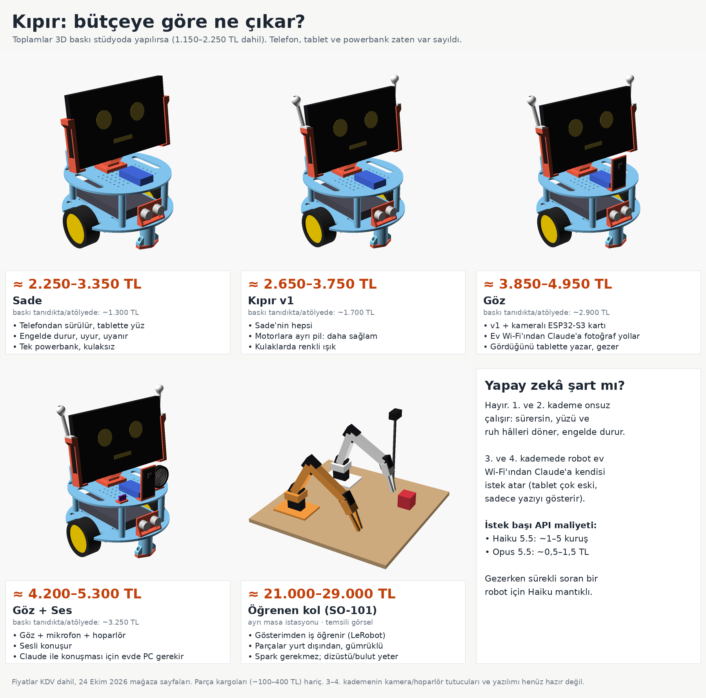

# Bütçeye göre Kıpır

**Varsayım:** yüz olarak Galaxy Tab 3 Lite (SM-T110) var; robotu günlük telefonunun
tarayıcısından sürüyorsun (telefon robota takılmıyor); powerbank var. Gece lambası,
Gamebox ve Corby kullanılmıyor. Fiyatlar KDV dahil, 24 Ekim 2026'da mağaza sayfalarından;
"~" ile başlayanlar tahmin. Görseli yeniden üretmek için: `python3 docs/butce_ciz.py`.

| Kademe | Elektronik | Toplam (baskı stüdyoda*) | Toplam (baskı tanıdıkta/atölyede) | Ne yapar? |
|---|---:|---:|---:|---|
| 1. Sade | ~1.100 TL | **≈ 2.250–3.350 TL** | ~1.300 TL | Telefondan sürülür, tablette 7 ifadeli yüz, engelde durur, uyur/uyanır |
| 2. Kıpır v1 | ~1.500 TL | **≈ 2.650–3.750 TL** | ~1.700 TL | + motorlara ayrı pil (powerbank kesilmez), kulak ışıkları |
| 3. Göz | ~2.680 TL | **≈ 3.850–4.950 TL** | ~2.900 TL | + kamera; ev Wi-Fi'ından Claude'a fotoğraf yollar, gördüğünü tablette yazar, ona göre gezer |
| 4. Göz + Ses | ~3.050 TL | **≈ 4.200–5.300 TL** | ~3.250 TL | + mikrofon ve hoparlör: sesli konuşur |
| 5. Öğrenen kol (SO-101) | yurt dışı | **≈ 21.000–29.000 TL** | – | Ayrı masa istasyonu; gösterimden iş öğrenir (LeRobot) |

\* Stüdyo baskısı 1.000–2.000 TL + kargo 150–250 TL. **Parça kargoları (~100–400 TL, mağaza
sayısına göre) hariç**; her mağazada 1.500 TL üstü genelde ücretsiz.

## Kademelerin parçaları

**Ortak (her kademe, ~1.103 TL):** ESP32 DevKit (WROOM-32) 377,76 · TB6612FNG 81,36 ·
2 × TT motor + teker 145,30 · HC-SR04 63,50 · jumper kablolar ~150 · breadboard 55,21 ·
buzzer ~20 · kondansatör/direnç ~40 · vidalar ~80 · 2 misket ~10 · cırt bant/sünger ~80.
Ayrıntı ve bağlantılar: [MALZEME.md](MALZEME.md).

1. **Sade:** sadece ortak parçalar. Motorlar powerbank'in ikinci çıkışından beslenir
   (`MOTOR_VOLT 5.0`); tablet kendi piliyle çalışır. Engele takılınca ESP32 resetlenebilir.
2. **Kıpır v1 (+~396 TL):** 2'li 18650 yuvası 38,46 + 2 × 18650 297,28 + şarj modülü ve
   1'li yuva ~30 + 2 kulak LED'i ~30.
3. **Göz (+~1.180 TL):** kameralı ESP32-S3 N16R8 kartı 1.111,50 (Robolink, stokta; USB'li,
   programlayıcı gerekmez) + kartı motor pilinden besleyecek 5 V düşürücü ~70.
4. **Göz + Ses (+~373 TL):** INMP441 mikrofon 145,29 + MAX98357A amfi 148,80
   (**şu an stokta yok**, beklemek ya da başka satıcı gerekebilir) + 1 W hoparlör 79,11.
5. **Öğrenen kol:** SO-101 resmi malzeme listesi 229,88 USD + 2 USB kamera ~26 USD + kargo;
   Şubat 2026'dan beri her pakete vergi (~%35–60 tahmini); baskı ~665 g, 2.000–4.000 TL.
   Parçalar Alibaba ve Amazon'a bölündüğü için en az iki paket olur. Tek paketlik bir kit
   (Hiwonder 256,99 / Seeed 277,99 USD, baskısız) gümrük işini azaltır.

## Yapay zekâ şart mı?

Hayır. 1. ve 2. kademe onsuz çalışır. 3. ve 4. kademede yapay zekâyı robotun kendisi
kullanır: kamera kartı ev Wi-Fi'ına bağlanır, fotoğrafı doğrudan Claude API'sine gönderir.
Tab 3 Lite bunu yapamaz (Android 4.2 modern HTTPS bağlantısı kuramıyor), sadece cevabı
ekranda gösterir.

**İstek başı API maliyeti** (VGA 640×480 fotoğraf ≈ 410 token + metin):

| Model | İstek başı | Not |
|---|---|---|
| Claude Haiku 5.5 | ~1–5 kuruş | Düşünme kapalıyken ~1 kuruş |
| Claude Opus 5.5 | ~0,5–1,5 TL | Düşünme kapatılamıyor; çıktı olarak ücretlendiriliyor |

Gezerken sık soru soran bir robot için Haiku mantıklı; istekleri seyrek tut (ör. sadece
engelde ya da komutla). Konsolda robota ayrı bir çalışma alanı açıp aylık harcama sınırı koy.

## 3. ve 4. kademe için henüz yapılmayanlar

- Kamera ve hoparlör tutucuları (görsellerde temsili; birkaç gramlık baskı).
- Yazılım:
  - Kamera kartının Claude'a fotoğraf gönderme kodu.
  - Tablet yüzünde yazı balonu.
  - Ana ESP32'nin ev ağına da bağlanması: `config.h`'de `WIFI_STA_SSID/PASS`. Tablet ve
    kamera kartı robota ev ağından ulaşır; ya da iki kart arasına UART kablosu çekilir.
- **API anahtarı** git'e giren `config.h`'ye yazılmamalı. Ayrı, `.gitignore`'daki bir
  dosyada ya da ilk kurulumda cihaz hafızasında (NVS) tutulmalı. Cihaz kaybolursa anahtarı
  iptal et.
- **Ses (4. kademe):** donanım, açık kaynak [xiaozhi-esp32](https://github.com/78/xiaozhi-esp32)
  yazılımının `bread-compact-wifi-s3cam` kart tanımıyla birebir uyumlu. Ama hazır ücretsiz
  sunucusu (xiaozhi.me) Çin'de çalışıyor ve konuşan model Claude değil (Qwen); ses oraya gider.
  Claude ile konuşturmak için evde sürekli açık bir bilgisayara kendi sunucusunu kurmak,
  ayrıca konuşmayı yazıya çeviren (ücretli) ve seslendiren (ör. EdgeTTS, Türkçe sesi var)
  bir servis bağlamak gerekir. Claude API'sinde ses girişi ve seslendirme yok.
