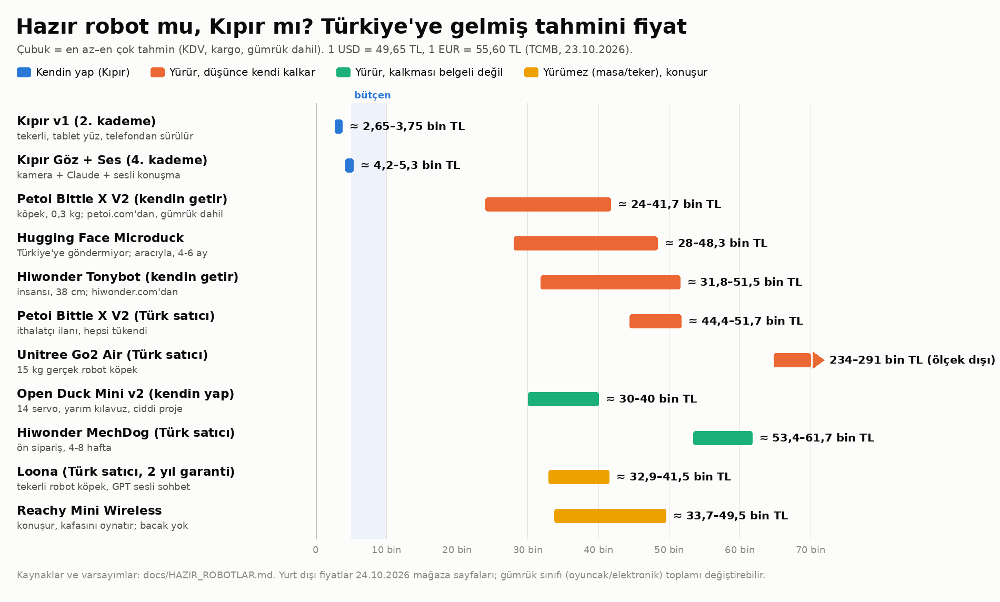

# Hazır robot almak: ne var, Türkiye'ye kaça gelir?

24 Ekim 2026'da üreticilerin ve Türk satıcıların sayfalarından derlendi.
1 USD = 49,65 TL, 1 EUR = 55,60 TL (TCMB, 23.10.2026). "Kendin getir" fiyatları
benim tahminim (ürün + kargo + gümrük + KDV), kimseden alınmış teklif değil.

## Kısa cevap

- **Yürüyen ve düşünce kendi kalkan hazır robot var, ama en ucuzu bile Kıpır v1'in
  7-12 katı:** Türkiye'ye gelmiş hâliyle ~24-42 bin TL (gümrük oyuncak sayarsa üst uç).
- Bacak isteğine en yakın üç seçenek: **Petoi Bittle X** (köpek, ~24-42 bin TL),
  **Hugging Face Microduck** (ördek, ~28-48 bin TL, Türkiye'ye göndermiyor, 4-6 ay
  bekleme) ve **Hiwonder Tonybot** (insansı, ~32-51 bin TL).
- **Yurt dışından tek paket getirmek 2026'da pahalı:** 30 Euro muafiyeti kalktı. Her
  pakete gümrük vergisi + KDV + 1.605,80 TL damga vergisi biner; DHL gibi kuryeler
  şahıs gönderisini müşavirle açtığı için ~4 bin TL daha eklenebilir (ayrıntı aşağıda).
- **Yürüyüp kalkanların hiçbiri Türkiye'de stokta değil.** Türk satıcı ilanları ABD fiyatının 2-4,5 katı ve
  çoğu "tükendi" ya da ön sipariş.
- **Küçük bacaklı robotların hepsi yaklaşık 1 saat çalışıp şarja gider ve tablet ya da
  telefon taşıyamaz.** Kıpır'daki "tablet yüz" fikri onlarla olmaz.
- **PhoneBot satılmıyor.** Sadece bir araştırma prototipi; kendin yaparsan servolar
  yüzünden ~45-55 bin TL.

## Bacaklı adaylar

| Robot | Boy / ağırlık | Yürür | Düşünce kalkar | Konuşur / yapay zekâ | Pil | Türkiye'de durum | Tahmini fiyat |
|---|---|---|---|---|---|---|---|
| **Petoi Bittle X V2** (köpek) | 20 cm, ~0,3 kg | evet | **evet** (jiroskop açıkken, üretici SSS'inde yazıyor) | 35+ sesli komut, internetsiz; sohbet yok | ~1 sa | Yetkili satıcı yok. İthalatçı ilanları 44-52 bin TL, hepsi tükendi | **kendin getir ≈24-42 bin TL** (petoi.com: hazır montajlı $339 plastik servo / $399 metal dişli) |
| **Hugging Face Microduck** (ördek) | 25 cm, <0,8 kg | evet | **evet** (resmi "ayağa kalk" hareketi) | konuşmaz, sadece ses efekti | ~1 sa | **Türkiye'ye göndermiyor.** AB/ABD adresli aracı firma gerekir. Yeni siparişe 4-6 ay | **≈28-48 bin TL** (ABD aracısı daha ucuz), teslim ~Şubat-Nisan 2027. İlk parti tükendi |
| **Hiwonder Tonybot** (insansı) | 38 cm, 1,8 kg | evet (yavaş) | **evet** (resmi sayfada yazıyor) | bulut yapay zekâ ses modülü (Advanced/Ultimate) | belirtilmemiş | Hiwonder Türkiye'ye gönderiyor. Robot Sepeti 83,7 bin TL, tükendi | **kendin getir ≈32-51 bin TL** ($468-585) |
| **Hiwonder TonyPi** (insansı, Raspberry Pi 5) | 37 cm, 1,8 kg | evet (yavaş) | evet | ChatGPT ile sesli/görüntülü (API anahtarı gerekir) | ~1 sa | Doğrudan Hiwonder'dan | **kendin getir ≈42-73 bin TL** ($670-870) |
| **Hiwonder MechDog** (köpek) | küçük, 8 eklem | evet (hızlı) | belgelenmemiş | AI sürümü Çin bulut modelleriyle (DeepSeek, Qwen) | ~1 sa | Robot Sepeti ön sipariş, 4-8 hafta | **53-62 bin TL** (Türkiye); kendin getir ≈22-39 bin TL |
| **ROBOTIS TIG** (mini insansı) | 18 cm | 8 eklemle sınırlı, doğrulanamadı | doğrulanamadı | blok kodlama, ses tanıma | belirtilmemiş | **Türkiye'de stokta tek seçenek** (Robot Sepeti) | **24,4 bin TL** |
| **Unitree Go2 Air** (gerçek robot köpek) | 15 kg | evet, merdiven de çıkar | **evet** | Air'de ses yok | 1-2 sa | Türkiye'de satılıyor (Robot Sepeti, 360 Teknoloji, resmi ortak Robotlar.org) | **234-291 bin TL** |
| **Open Duck Mini v2** (Microduck'ın açık kaynak atası) | 42 cm | evet | belgelenmemiş | isteğe bağlı paket | belirtilmemiş | Satılmıyor, kendin yaparsın. İzmir'de Hashtag Robotics "yakında" diyor, fiyat yok | **kendin yap ≈30-40 bin TL** + 3D baskı |
| **PhoneBot** (UCLA) | 48 cm, 1,8 kg | düz zeminde | yüzüstüden kalkıyor (basında) | telefonla | belirtilmemiş | **Satılmıyor**, kit yok, kodu henüz yayımlanmadı | kendin yap ≈45-55 bin TL + telefon |
| **Unitree R1** (çocuk boyu insansı) | 1,23 m, 27 kg | evet, koşar | gösterimlerde evet | çok kipli yapay zekâ | ~1 sa | Türkiye ortağından teklifle | ≈315-530 bin TL; programlamak için EDU sürümü (≈945 bin TL) |

## Bacaksız ama konuşanlar

| Robot | Ne yapar | Türkiye'de durum | Tahmini fiyat |
|---|---|---|---|
| **Reachy Mini Wireless** (Pollen / Hugging Face) | Kafasını ve antenlerini oynatır, kameralı, 4 mikrofon. Kişilik verdiğin sesli sohbet, 70+ hazır uygulama. **Bacak yok**, masada durur | Türkiye'ye Seeed Studio'dan (Çin deposu, stokta) | **≈34-49 bin TL**; kablolu Lite sürümü ≈28-42 bin TL (bilgisayara bağlı çalışır) |
| **Loona** (KEYi) | Tekerli robot köpek. GPT-4o ile sesli sohbet (üretici "şimdilik ücretsiz" diyor), insanı takip eder, oyun oynar, kendi şarjına gider | Türkiye'de satılıyor, 2 yıl distribütör garantisi (360 Teknoloji, Teknosa, Trendyol) | **≈33-41 bin TL** |
| **EMO** (LivingAI) | Masada gezen yüzlü küçük robot. Sesli komut, ChatGPT destekli cevaplar | Türk e-mağazalarında var | **≈30-42 bin TL** |
| **Vector 2.0** | Paletli, kaldırma kollu masa robotu. Yapay zekâ özellikleri aylık abonelik ister | Türk e-mağazalarında var | **≈29-32 bin TL** |
| **LOOI** | Telefonun yüz ve beyin olduğu tekerli taban (iPhone 12+, Android beta) | 360 Teknoloji, kritik stok | **≈28-29 bin TL** |
| **Eilik** | Yerinden kıpırdamayan, dokununca tepki veren masa arkadaşı. Sohbet yok | Amazon.com.tr, Hepsiburada, 360 Teknoloji | **≈18-24 bin TL** |

Bu robotların hiçbiri yürümez; Türk satıcı fiyatları ABD fiyatının 1,5-3 katı. Garanti
ve fatura isteyen biri için Loona yerelden almak, kendin getirmekten bile ucuz.

## Türkiye'ye getirirken

- **30 Euro muafiyeti 6 Şubat 2026'da kalktı** (Cumhurbaşkanı Kararı 10813).
- **Bakanlığın güncel SSS'i (5 Mart 2026):** 1.500 Euro ve 30 kg'a kadar şahsi kargoda
  kurye senin adına ayrıntılı beyan verebilir. Normal vergiler ödenir (gümrük vergisi +
  ilave gümrük vergisi + %20 KDV), üstüne depolama ve müşavirlik ücreti çıkabilir.
  İnternette hâlâ yazan "AB'den %30, diğer ülkelerden %60 tek oran" artık sadece ilaç ve
  takviye için geçerli.
- **Paket başına sabit masraf 1,6-6,3 bin TL:** her beyannamede 1.605,80 TL damga
  vergisi var. DHL Express Türkiye ilaç, takviye ve kitap dışındaki şahıs gönderilerini
  müşavirle normal ithalat olarak açıyor: müşavir asgari ücreti 3.320 TL + KDV ve kurye
  ücreti de eklenir. Bakanlık SSS'i bu ücretler konusunda kendisiyle çelişiyor; kuryeye
  göre değişiyor.
- **Oyuncak riski:** 20 Ekim 2025'ten beri (Genelge 2025/11) oyuncaklar basitleştirilmiş
  usulle gelemez; normal beyanla çekilir, ürün güvenliği denetimine de takılabilir. Gümrük robotu oyuncak
  (GTİP 9503) sayarsa Çin ya da ABD menşeine %4,7 gümrük vergisi + %15-25 ilave gümrük
  vergisi biner. Makine (8543/8479) sayarsa ~%2 gümrük vergisi.
- **Örnek:** $399'luk robot (etiket fiyatı 19,8 bin TL) + kargo; makine sayılır ve
  müşavir gerekmezse ~28 bin TL, oyuncak sayılır ve müşavirle açılırsa ~42 bin TL;
  etiketin 1,4-2,1 katı. Bu belgedeki "kendin getir" aralıkları bu iki uçla hesaplandı.
- **AB aracı adresi** çoğu zaman daha pahalı: önce AB KDV'si, sonra Türk KDV'si ödenir.
- **En ucuz yasal yol, bavul:** yurt dışından gelen bir yolcu kişi başı 430 Euro'ya
  kadar eşyayı vergisiz getirebilir (15 yaş altı 150 Euro). 340 Euro'luk Microduck ya da
  $339'luk Bittle bu yolla vergisiz gelir.
- **Lityum pil:** cihazın içindeki pil normal kargoyla gider; yedek pilleri ayrı
  gönderme, Türkiye'den al.

## Bacaklı robotun evdeki gerçekleri

- **Pil yaklaşık 1 saat.** Bittle, Microduck ve Hiwonder robotlarının hepsi bu civarda.
  Teker, servo bacaktan çok daha az enerji harcar; tekerli robot aynı pille daha uzun gider.
- **Halı, kapı eşiği ve kablo engeldir.** Küçük servolu bacaklılar yavaş yürür ve
  düz zemin ister.
- **Servolar aşınır, düşmeler kırar.** Ucuz kitlerde plastik dişliler zamanla boşluk
  yapar. Yedek servo bulmak yurt dışından sipariş demek. Bittle'da metal dişli sürüm
  bu yüzden daha mantıklı.
- **Taşıyamazlar.** 0,3-1,8 kg'lık robot 300 g'lık tableti sırtında taşıyamaz. Yüz
  ekranı ya robotun içindeki küçük ekran olur ya da hiç olmaz.
- **"Yapay zekâ" çoğunlukla bulut API'si.** TonyPi ChatGPT, MechDog AI Çin modelleri
  kullanır. Hepsi API anahtarı ve internet ister; yani bizim Kıpır'daki Claude
  bağlantısıyla aynı şey, sadece hazır paketlenmiş.
- **Garanti pratikte yok.** Arızada robotu Fransa'ya, ABD'ye ya da Çin'e kendi
  masrafınla göndermen gerekir.
- **Microduck henüz kimsenin elinde değil.** İlk üretim; dayanıklılığını gösteren
  bağımsız inceleme yok. Ayrıca üretici 16 yaş üstünü öneriyor ve konuşmuyor.
- **Sahte Microduck mağazalarına dikkat:** microduck.shop ve microducks.org resmî
  mağazayla çelişen koşullar sunuyor. Sadece store.pollen-robotics.com'dan alınmalı.
  (Not: Nvidia, Hugging Face'i satın alıyor; işlemin 2027'nin ilk yarısında bitmesi
  bekleniyor.)

## Önerim

- **5-10 bin TL bütçeyle bu listedeki hazır robotların hiçbiri alınamıyor.** En ucuz
  yürüyen ~30 bin TL'den başlıyor. Bu bütçede doğru yol, Türkiye'de stokta olan parçalarla
  kendi küçük robotumuzu yapmak (Kıpır gibi).
- **Bacak şartsa ve bütçe 30-40 bin TL'ye çıkabiliyorsa: Petoi Bittle X V2, metal dişli
  ($399).** Düşünce kalkması belgeli, açık kaynak, ESP32 tabanlı ve bugün sipariş
  edilebiliyor. Yurt dışından gelen bir tanıdık bavulunda getirirse vergisiz, ~20 bin TL'ye
  gelir.
- **Microduck için acele etme.** Para siparişte çekiliyor, teslim 4-6 ay sonra. İlk
  teslimatlar ve bağımsız incelemeler çıktıktan sonra karar vermek daha güvenli.
- **Yürümesi şart değil ama konuşması ve garantisi önemliyse:** Loona'yı Türk
  distribütöründen almak, kendin getirmekten ucuz ve 2 yıl garantili.
