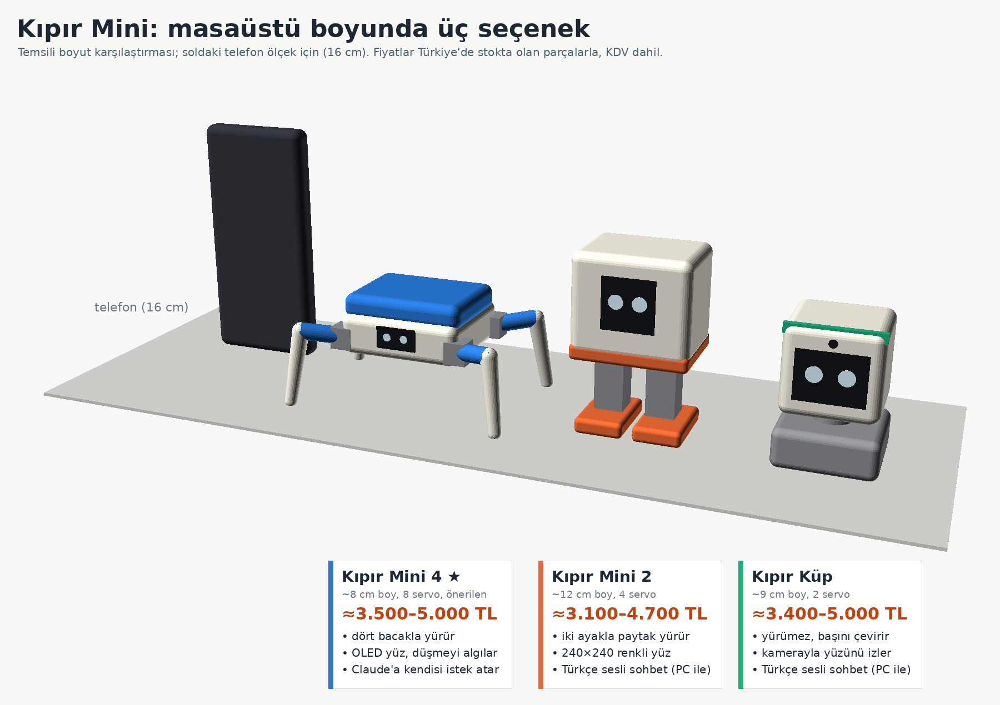

# Kıpır Mini: 5-10 bin TL'ye masaüstü robot

24 Ekim 2026. Bütün parçalar Türkiye'de stokta olan mağazalardan seçildi (Robotistan,
Direnc, Motorobit, Amazon.com.tr). Fiyatlar KDV dahil ve o günün sayfalarından alındı.
Direnc ile Motorobit dolara bağlı fiyat verdiği için rakamlar her gün biraz oynar.

## Neden yurt dışından değil?

Şubat 2026'dan beri 30 Euro muafiyeti yok. AliExpress/PTT paketleri gümrükte bekletiliyor,
müşavir 3.984 TL ve damga vergisi ~1.650 TL istiyor; üstüne vergi geliyor. 50 dolarlık bir
kit buraya 3,5-4 katına geliyor. Bu yüzden her parça Türkiye stoğundan seçildi.
Ayrıntılar: [HAZIR_ROBOTLAR.md](HAZIR_ROBOTLAR.md).

## Üç seçenek

| | **Kıpır Mini 4** (önerilen) | **Kıpır Mini 2** | **Kıpır Küp** |
|---|---|---|---|
| Neye dayanıyor | [Sesame](https://github.com/dorianborian/sesame-robot) (Apache-2.0) | [xiaozhi Otto](https://github.com/78/xiaozhi-esp32) (yazılım MIT, gövde CC BY-NC-SA) | StackChan benzeri, kendi tasarımımız |
| Boy | ~8 cm, avuç içi | ~12 cm | ~9 cm |
| Yürür mü | **evet, dört bacak, 8 servo**; ileri, geri, dönme, yengeç adımı + ~15 hareket | evet, iki ayak, 4 servo; paytak Otto yürüyüşü | hayır; başını sağa sola ve aşağı yukarı çevirir |
| Yüz | 0,96" OLED (Sesame'in hazır yüz kütüphanesi) | 1,3" 240×240 renkli ekran, 21 animasyonlu göz | 1,69" renkli ekran + kamera |
| Claude | **robot kendisi HTTPS ile istek atar** | evdeki bilgisayardaki sunucu atar | evdeki bilgisayardaki sunucu atar |
| Türkçe ses | 1. aşamada telefondan; 2. aşamada robotun kendi mikrofonu ve hoparlörü + PC sunucusu | **ilk günden** robotun kendisinden (PC sunucusu açıkken) | robotun kendisinden (PC sunucusu açıkken) |
| Düşünce kalkar mı | hayır; düştüğünü algılar, motorları durdurur, "beni çevirir misin?" der | hayır | yürümüyor |
| Zorluk | orta, ~2-3 hafta sonu | orta, ~2 hafta sonu | yüksek (iki işlemci, üç ayrı yazılım) |
| **Toplam** | **≈3.500-5.000 TL** | **≈3.100-4.700 TL** | **≈3.400-5.000 TL** |

Toplamlara parçalar, 3D baskı (studyoda ~350-900 TL) ve kargo dahil. Havya ve multimetre
yoksa ~1.000 TL ekleyin; regülatörlerin voltajını ayarlamak için ikisi de gerekli.

**Neden Mini 4?** En iyi o yürüyor. Claude'a gerçekten robotun kendisi istek atıyor.
Yazılımı Arduino, yani Kıpır v1'deki deneyim doğrudan işe yarıyor. Tasarım dosyaları
açık ve GitHub'dan indirilebiliyor. **Mini 2** "yürüyen ve Türkçe konuşan robota" en
kısa yol, ama yürüyüşü daha zayıf ve Claude'a ancak bilgisayar açıkken ulaşıyor.
**Küp** sevimli ama yürümüyor ve yeni başlayan biri için en zor olanı.

## Kıpır Mini 4: parça listesi (denetimden sonraki hâli)

| Parça | Adet | Birim TL | Nereden |
|---|---|---|---|
| ESP32-S3 N16R8 geliştirme kartı (pinsiz istenmeli) | 1 | 610,23 | [Direnc](https://www.direnc.net/esp32-s3-n16r8-wifi-bluetooth-board) |
| MG90S servo, 180° (8 + **4 yedek**; ara dişlileri plastik) | 12 | 125,80 | [Robotistan](https://www.robotistan.com/mg90s-servo-motor) |
| 0,96" SSD1306 OLED (yüz) | 1 | 162,73 | [Direnc](https://www.direnc.net/128x64-096-4-pin-oled-grafik-lcd-ekran-ssd1306-i2c-mavi) |
| MPU6050 eğim sensörü (düşme algılama) | 1 | 193,53 | [Robotistan](https://www.robotistan.com/mpu6050-6-eksen-ivme-ve-gyro-sensoru-6-dof-3-axis-accelerometer-and-gyros) |
| 14500 Li-ion pil, 3C (AA boyu) | 2 | 105,48 | Direnc |
| Tekli kablolu AA yuvası (2'si robotta seri, 2'si şarjda) | 4 | 7,86 | [Robotistan](https://www.robotistan.com/aa-pil-icin-tekli-pil-yuvasi-kablolu) |
| 2S 5A BMS pil koruma kartı (orta uç bağlanmalı) | 1 | 45,24 | [Robotistan](https://www.robotistan.com/2s-5a-bms-lityum-pil-koruma) |
| TP4056 Type-C şarj modülü (piller robotun dışında, tek tek şarj) | 2 | 21,77 | [Robotistan](https://www.robotistan.com/tp4056-type-c-1s-37v-lipo-li-ion-pil-sarj-devresi) |
| MP1584 3A voltaj düşürücü (servolar, 5,1-5,3 V) | 1 | 53,22 | [Robotistan](https://www.robotistan.com/3a-mini-ayarlanabilir-voltaj-dusurucu-regulator-karti-step-down) |
| 2A mini voltaj düşürücü (**3,3 V'a ayarlanıp 3V3 pinine**) | 1 | 33,26 | [Robotistan](https://www.robotistan.com/2a-mini-ayarlanabilir-voltaj-dusurucu-regulator-karti) |
| KCD1 anahtar, kondansatörler (1000 µF ×2, 470 µF), delikli pertinaks, pin header, JST kablo, jumper, makaron, M2 vida | - | ~280 | Robotistan |
| **İsteğe bağlı, robotun kendi sesi:** INMP441 mikrofon + MAX98357A amfi + 1 W hoparlör | 1+1+1 | 145,29 + 309 + 79,11 | Direnc, [Amazon](https://www.amazon.com.tr/dp/B0FGPXW8SN) (son 12 adet), Robotistan |
| 3D baskı: 11 parça PLA, ~90-100 g | - | 350-850 | baskı stüdyosu |

Elektronik ~3.100 TL (sessiz) / ~3.630 TL (sesli). Baskı ve kargoyla **≈3.500-5.000 TL**.
Robotistan ve Direnc siparişlerini 1.500 TL'nin üstüne toplarsanız kargo bedava.

### Denetçinin bulduğu ve listeye işlenen düzeltmeler

- **Pil yuvası sığmıyor.** Sesame gövdesindeki pil boşluğu ~54 × 29 × 12,5 mm, hazır 2'li
  yuva bu ölçüye girmiyor. Tekli yuvalar kullanılacak ve gövdeye küçük bir değişiklik
  yapılacak (dosyalar açık, ben düzenleyebilirim). Diğer yol, hazır 2S pil paketiyle
  dengeli şarj cihazı almak.
- **BMS'nin orta kabloya ihtiyacı var.** İki tekli yuva bu bağlantıyı veriyor.
- **ESP32'nin resetlenmemesi için:** mantık regülatörü 3,3 V'a ayarlanıp doğrudan 3V3 pinine
  bağlanacak. Servo akımı pili çektiğinde bile ESP32 ayakta kalır.
- **Servolar tam metal değil.** Robotistan'ın MG90S'inde ara dişliler plastik; bu yüzden
  4 yedek konuldu.
- **İçerisi dar.** Pertinaks ~3 × 3,5 cm'ye kesilecek; amfi ve hoparlör küçük bir "sırt
  çantası" parçasına gidecek.
- **Claude isteği ayrı görevde çalışmalı.** Yoksa robot cevap beklerken yüzü ve yürüyüşü
  donar. Kendi küçük istemcimizi yazacağız (efor "low", sıcaklık gibi ayarlar yok, sertifika
  doğrulamalı).

### Yapım sırası

1. **Masada dene:** ESP32, OLED, MPU6050 ve 2 servo breadboard'da. Regülatörleri
   multimetreyle ayarla.
2. **Ölçüp bastır:** kartın gerçek ölçüsüne göre gövdeyi ayarla, sonra stüdyoya gönder.
3. **1. aşama:** Sesame yazılımı, bizim pinlerimizle yürür. Claude'a robot kendisi istek
   atar; Türkçe dinleme ve konuşmayı telefon yapar (Kıpır v1'deki gibi).
4. **2. aşama (isteğe bağlı):** robotun kendi mikrofonu ve hoparlörü. Bunun için evdeki
   bilgisayarda xiaozhi sunucusu çalışır: Whisper Türkçeyi yazıya çevirir, Claude Haiku
   cevaplar, EdgeTTS Türkçe sesle okur.

## Kıpır Mini 2 (Otto) kısaca

- **Parçalar:** ESP32-S3 N16R8, 1,3" 240×240 ST7789 ekran (Motorobit 315 TL), INMP441 +
  MAX98357A + hoparlör, 5 × MG90S, tırnaklı tek 18650 pil (yuva sığmıyor), TP4056 korumalı
  şarj, 2-3 A'lik anahtar, gövdenin dışına konulan bas-konuş düğmesi. Parçalar ~2.600 TL,
  baskı ve kargoyla **≈3.100-4.700 TL**.
- **Artısı:** hazır resmî yazılım (xiaozhi `otto-robot`), Türkçe arayüz, 21 ifade.
  Claude yürü, dans et gibi komutları kendisi çağırır.
- **Eksisi:** gövde dosyaları makerworld.com.cn'de (hesap gerekiyor). Claude'a sadece
  bilgisayar açıkken ulaşır. Türkçe uyandırma kelimesi yok, bas-konuş ile çalışır.

## Kıpır Küp kısaca

- **Parçalar:** ESP32-S3 (ses ve Claude) + ESP32-CAM (yüz takibi) + 1,69" ekran + 2 SG90 +
  ses parçaları. **≈3.400-5.000 TL.**
- **Diğer yollar:** resmî StackChan Türkiye'de satılmıyor. Bavulla gelirse ~4,9 bin TL,
  kuryeyle ~13-14 bin TL.
- **Eksisi:** yürümüyor ve en zor yapılanı. Konuşurken yüz takibi duruyor. Sunucu,
  fotoğraf cevaplarını Çinceye zorluyor (tek satırlık yamayla düzelir).
- **Sonra:** ilerde bir Mini 4 gövdesinin üstüne kafa olabilir.

## Her üçü için bilinmesi gerekenler

- **Hiçbiri düşünce kendi kalkmaz.** Bu boyutta ve fiyatta bu, ayrı bir araştırma işi.
- **Ses için telefon ya da açık bir bilgisayar gerekir.** Claude sesle çalışmaz.
  Galaxy Tab 3 bu iş için çok eski.
- **API maliyeti küçük:** Claude Haiku 5.5 ile günde 100 konuşma ayda ~60-135 TL.
  - API anahtarı robotun kodunda olmamalı. Bilgisayar sunucusunda ya da cihaz
    ayarlarında, aylık harcama sınırı konmuş ayrı bir anahtar kullanılmalı.
- **Li-ion güvenliği:** pile lehim yapılmaz, pil gözetimsiz şarj edilmez, şarj robotun
  dışında yapılır.
- **Yürüyüş yavaş:** adım başına birkaç cm. Düz masada ya da parkede iyi; halıda ve camda
  zorlanır.
