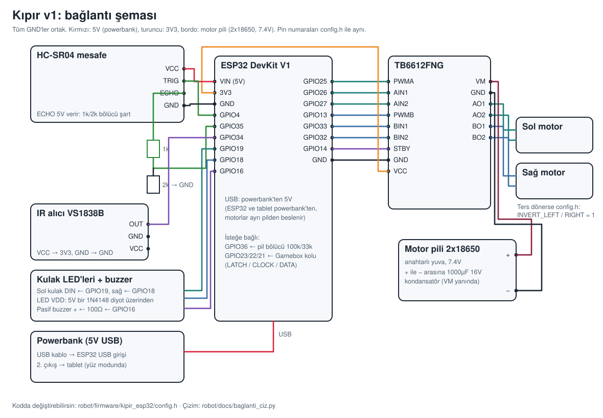

# Montaj ve bağlantılar



## Gerekenler

Yıldız ve düz tornavida, pense, multimetre (çok faydalı), çift taraflı bant, zip-tie.
Kulak LED'leri dışında lehim şart değil (jumper ve breadboard yeter). Ama motor kablolarını
lehimlemek ve kondansatörü sürücüye yakın lehimlemek daha sağlamdır.

## 1. Mekanik montaj

1. **Baskıları temizle.** Ø2,7 mm'lik kılavuz deliklere bir M3 vidayı bir kez takıp çıkar;
   sonraki takma kolaylaşır.
2. **Motorlar:** TT motorun dişli kutusunu taban altındaki duvara yasla; mil, duvardaki büyük
   deliğe gelsin, motor ucu ve kabloları arkaya baksın. **M3×30 cıvatayı teker tarafından**
   (dişli kutusunun dış yüzünden) geçir, **somunu iç tarafta** sık. Böylece teker tarafında
   sadece cıvata başı kalır.
3. **Tekerler:** mile it ama sonuna kadar bastırma; gövdeye ve cıvata başlarına sürtmesin
   (1-2 mm boşluk).
4. **Misket tekerler:** tabanı ters çevir, 16 mm misketleri direklerin ucundaki yuvaya koy.
   Kapağı üstüne oturt. Robotu düz çevirip kapağı alttan tutarken tabandaki 7 mm deliklerden
   tornavidayla **M3×10** vidaları kapağa vidala. Ön misket yerden 1 mm yukarıda durur, bu
   kasıtlı: robot 3 noktaya basar, yalpalamaz.
5. **Sensör tutucu:** önce tutucuyu tabanın önüne vidala: **M3×12** vidaları tabanın altından
   geçir, somunları tutucunun ayağının üstünde sık. Sonra HC-SR04'ü **ters çevirip** (pinleri
   yukarı bakacak şekilde) iki "gözünü" plakadaki deliklere geçir; böylece kablolar tabana
   değil yukarı, üst kata doğru çıkar.
6. **Powerbank:** tabanın ortasına koy, cırt bandı yuvalardan geçirip sıkıca bağla.
   Altına bir parça sünger bant yapıştırırsan kaymaz.
7. **Motor kablolarını** motorun arkasındaki 10 mm deliklerden yukarı al.
8. **Boyun:** üst katı tabana takmadan önce boynu üst kata, alttan **4 × M3×10** ile vidala
   (boyundaki kablo kanalı üst kattaki dikdörtgen deliğin üstüne gelir). Üst kat takıldıktan
   sonra bu vidalara powerbank yüzünden tornavida sığmaz.
9. **Üst kat:** direkleri tabandaki deliklere oturt, tabanın altından **4 × M3×16** ile vidala.
10. **Kafa rayı:** iki **M3 somunu** rayın ön yüzündeki altıgen yuvalara bastır. Rayı
    boyunun eğik plakasına arkadan **2 × M3×10** ile vidala.
11. **Çeneler:** her çenenin altıgen yuvalarına 2 somun bastır. Çeneyi raya, rayın arkasından
    **pul + M3×10** ile tak, vidaları hafif bırak. Telefonu ya da tableti iki çenenin arasına
    yerleştir, çeneleri cihaza dayayıp vidaları sık. Boşluk kalırsa çenenin içine EVA sünger
    bant yapıştır.
    - Şarj kablosu, çenenin yan duvarındaki pencereden geçer.
    - Telefonun ön kamerası çenenin dudağına denk gelirse telefonu 180° çevir.
12. **Kulaklar (isteğe bağlı):** WS2812D-F5 LED'in 4 bacağına ince uzatma telleri lehimle
    (makaronla ayrı ayrı yalıt; bacak sırası LED'in veri sayfasında). Telleri tepedeki
    yuvadan çubuğun içinden geçirip arkadaki delikten çıkar, LED'i yuvaya it. Kulağı çenenin
    üst bloğuna **M3×8** ile vidala.

## 2. Elektronik yerleşimi

- **Üst katın ön ızgarası:** ESP32 + TB6612 (breadboard üzerinde) ve buzzer. ESP32'nin USB
  girişi kolay ulaşılacak yöne baksın.
- **Üst katın arka ızgarası** (boynun arkası): 2×18650 pil yuvası, zip-tie ile.
- **IR alıcı:** önde, kumandayı görecek yerde (ızgaraya ya da sensör tutucunun üstüne).
- 10 mm aralıklı ızgara delikleri M3 vida, zip-tie ve aralayıcılar için.

## 3. Bağlantı tablosu

| ESP32 | Bağlandığı yer | Not |
|---|---|---|
| GPIO25 | TB6612 PWMA | sol motor hız |
| GPIO26 / GPIO27 | TB6612 AIN1 / AIN2 | sol motor yön |
| GPIO13 | TB6612 PWMB | sağ motor hız |
| GPIO33 / GPIO32 | TB6612 BIN1 / BIN2 | sağ motor yön |
| GPIO14 | TB6612 STBY | |
| 3V3 | TB6612 VCC, VS1838B VCC | |
| GND | **her şeyin GND'si** (TB6612, pil −, sensörler) | ortak toprak şart |
| VIN (5V) | HC-SR04 VCC, LED'ler (1N4148 diyot üzerinden) | USB'den gelen 5V |
| GPIO4 | HC-SR04 TRIG | |
| GPIO35 | HC-SR04 ECHO, **1k + 2k bölücü** üzerinden | ECHO 5V verir; bölücüsüz bağlama |
| GPIO34 | VS1838B OUT | |
| GPIO19 / GPIO18 | sol / sağ kulak LED'i DIN | |
| GPIO16 | pasif buzzer +, 100 Ω üzerinden | |
| GPIO36 | (isteğe bağlı) pil + → 100k → GPIO36 → 33k → GND | `USE_BAT 1` |
| GPIO23 / 22 / 21 | (isteğe bağlı) Gamebox kolu LATCH / CLOCK / DATA | `USE_NES_PAD 1`, kol VCC → 3V3 |

| TB6612 | Bağlandığı yer |
|---|---|
| VM | 2×18650 pil + (anahtardan sonra) |
| GND (motor tarafı) | pil − ve ESP32 GND |
| AO1 / AO2 | sol motor |
| BO1 / BO2 | sağ motor |
| VM ile GND arası | **1000 µF 16V kondansatör** (+ bacağı VM'e) |

## 4. Güç

- **Powerbank** → USB kablo → ESP32 (ve yüz modundaysa ikinci çıkıştan tablet).
- **2×18650 (7,4 V)** → TB6612 VM. Firmware, motora en fazla ~6 V ortalama gerilim
  verecek şekilde PWM'i sınırlar (`MOTOR_VOLT 7.4`).
- Ayrı pil almadan başlamak istersen: powerbank'in **ikinci USB çıkışına** ucu kesilmiş bir
  USB kablo tak, kırmızı teli TB6612 VM'e, siyahı GND'ye bağla ve `config.h`'de
  `MOTOR_VOLT 5.0` yap. VM'i ESP32'nin VIN pininden besleme: motor akımı kartın
  üzerindeki küçük diyottan geçmesin. Robot engele takıldığında ESP32 resetleniyorsa
  motorlara ayrı pil zamanı gelmiştir.
- **Güvenlik:**
  - 18650'leri korumalı şarj modülüyle ya da 18650 şarj aletiyle, gözetim altında şarj et.
  - Ters takma: yuvadaki + / − işaretine bak.
  - Drone LiPo'sunu kullanacaksan koruma devresi olmalı; şişmiş pil kullanma.
  - Tab 3 Lite'ın pili 10 yaşında; kasası kabarıksa robota takma.

## 5. Yazılımı yükle

### Arduino IDE ile
1. Arduino IDE 2'yi kur. Tercihler'e ESP32 kart adresini ekle, Kart Yöneticisi'nden
   **esp32 by Espressif**'i kur (3.x ya da 2.0.17; ikisiyle de derlendi).
2. `robot/firmware/kipir_esp32/` klasörünü aç (`kipir_esp32.ino`).
3. Kart: **ESP32 Dev Module**. Partition Scheme: **Huge APP (3MB No OTA/1MB SPIFFS)**
   (telefon beyni için BLE açıkken şart).
4. `config.h`'yi gözden geçir (Wi-Fi adı/şifresi, motor gerilimi, takılı olanlar), yükle.

### PlatformIO ile
```bash
cd robot/firmware/kipir_esp32
pio run -t upload && pio device monitor
```

## 6. İlk deneme (tekerler havadayken)

1. Robotu bir kutunun üstüne koy, tekerler boşta dönsün. Motor pilinin anahtarını aç,
   ESP32'yi powerbank'e bağla. Buzzer "selam" çalar.
2. Telefonla **Kipir** Wi-Fi ağına bağlan (şifre `kipir1234`), tarayıcıda
   **http://192.168.4.1** aç: kumanda sayfası.
3. Joystick'i ileri it: iki teker de ileri dönmeli. Dönmeyen ya da ters dönen varsa
   `INVERT_LEFT/RIGHT`'ı değiştir ya da o motorun kablolarını çevir.
4. Elini sensörün önüne 10 cm'ye koy: ileri gitmemeli, buzzer "engel" sesi çıkarmalı.
5. Kumanda sayfasındaki **"Gece lambası kumandasını öğret"** bölümünden her tuşu öğret.
   Kumandaya basınca bu bölümdeki "Son okunan kod" değişmiyorsa kumanda IR değil RF olabilir:
   telefon kamerasıyla kumandanın ucuna bakıp tuşa bas, ışık görünmüyorsa RF'tir
   (bkz. [ARASTIRMA.md](ARASTIRMA.md#kumandalı-rgb-gece-lambası)).
6. Yere indir ve sür.

### Tableti yüz yapmak
Tab 3 Lite'ı da **Kipir** ağına bağla, tarayıcıda **http://192.168.4.1/yuz** aç. Ekrana
dokununca "Tam ekran" çıkar. Ekran kararmasın diye: Ayarlar → Geliştirici seçenekleri →
"Uyanık kal" (şarjdayken). Tablet powerbank'in ikinci çıkışından şarj olurken açık kalır.

### Telefonu beyin yapmak
`robot/web/beyin.html` HTTPS ile açılmalı (Web Bluetooth ve kamera bunu ister). Bu depo
Cloudflare Pages'te yayınlanıyorsa adres `https://<site>/robot/web/beyin.html` olur.
Android'de **Chrome** ile aç → Ayarlar'a Claude API anahtarını gir → "Robota bağlan" →
listeden **Kipir**'i seç. "Konuş"a basıp konuş, "Keşif" ile etrafı gezsin, "Elle sür" ile
ekrandan ya da USB/Bluetooth oyun kumandasıyla sür. iPhone'da Web Bluetooth yok
(Bluefy tarayıcısı ile olur).
