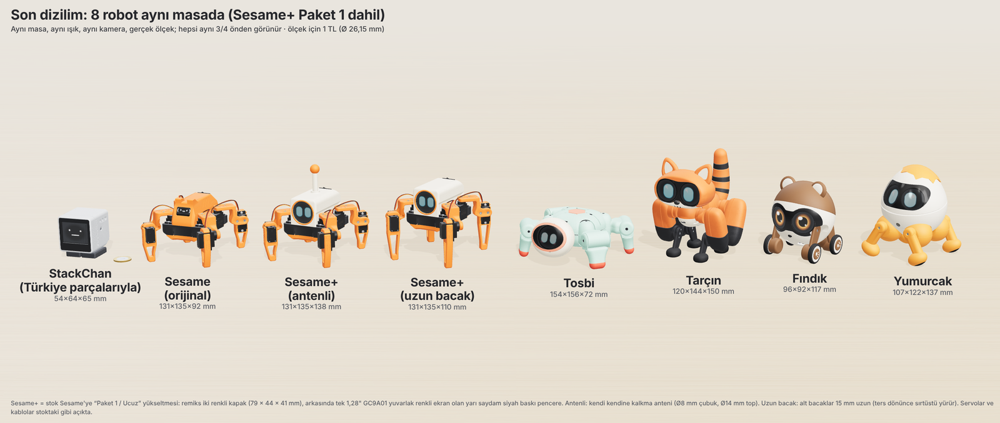
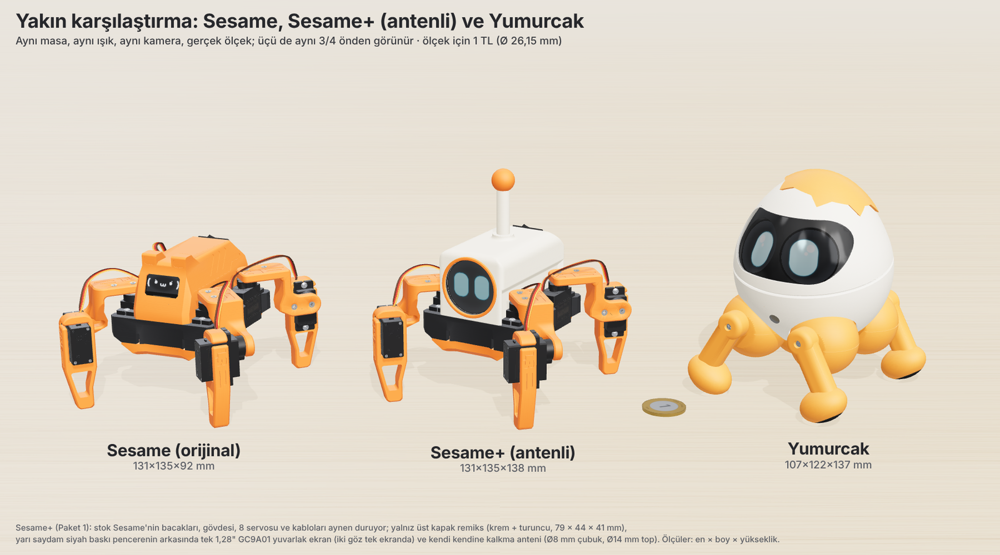

# Sesame ve StackChan, bizim dört robotla karşılaştırma

25 Ekim 2026. Soru: Sesame mi iyi, bizim tasarımlar mı? Sesame gerçekte kaça mal olur?
Sesame'i geliştirmek mantıklı mı? StackChan nasıl? Kural: **bütün parçalar Türkiye'deki
mağazalardan** alınır; yurt dışından kit ya da parça yok.

Hepsi aynı masada, aynı ışık ve kamerayla, gerçek ölçekte çizildi. Sesame resmî CAD
montajından ve deposundaki STL'lerden kuruldu; resmî fotoğrafıyla karşılaştırılıp
doğrulandı. StackChan, Türkiye parçalarıyla yapılacak hâliyle çizildi.

## Jürinin tablosu

İki bağımsız jüri (biri aile gözüyle, biri mühendis gözüyle) bütün adayları önceki ölçütlerle
puanladı: görünüş %35, yürüyüş ve kalkma %40, maliyet ve yapım %25. Dört tasarımın puanları
yeniden kontrol edildi, değişmedi.

| Aday | Aile | Mühendis | Gerçek maliyet (Türkiye) |
|---|---|---|---|
| Fındık (tekerlekli hamster) | 6,7 | 6,7 | 5.470-6.850 TL |
| **Yumurcak** (yürüyen yumurta) | **6,5** | **6,5** | **5.620-6.930 TL** |
| Yumurcak, sade sürüm | 6,3 | 6,5 | 4.860-5.810 TL |
| Sesame+ Ucuz, antenli | 6,2 | 5,9 | 3.630-4.250 TL |
| Tosbi (iki yüzlü kaplumbağa) | 6,1 | 6,1 | 6.050-7.400 TL |
| Tarçın (kırmızı panda) | 6,0 | 6,0 | 6.330-7.730 TL |
| Sesame+ Ucuz, uzun bacaklı | 6,0 | 5,9 | 3.630-4.250 TL |
| Sesame+ Orta (robotta ses, kenar sensörü) | 5,7 | 5,5 | 5.030-5.950 TL |
| Sesame, olduğu gibi | 5,0 | 5,0 | 3.490-4.200 TL |
| StackChan kopyası, kamerasız | 4,5 | 4,0 | 3.030-3.800 TL |
| StackChan kopyası, kameralı | 4,2 | 4,1 | 3.950-4.680 TL |

Maliyetlerin hepsi aynı yöntemle hesaplandı. Dahil olanlar:
- parçalar (KDV dahil, 24-25 Ekim'de mağaza sayfalarından doğrulandı)
- stüdyoda 3D baskı
- kargo
- fiyat oynamasına karşı bir pay

Havya ve multimetre (yoksa 750-1.050 TL) ile Claude API kredisi (~200-250 TL) dahil değil.

**Gerçek donanım:** bu listede yalnızca Sesame gerçekten yapılıp yürüdüğü görülmüş bir robot.
Geri kalanlar şimdilik CAD ve simülasyon. Yapım riskinin düşükten yükseğe sırası:
Sesame < StackChan kopyası ≈ Sesame+ < Fındık < Yumurcak ≈ Tosbi < Tarçın.

## Sesame

**Olduğu gibi Sesame bu iş için zayıf (5,0).**
- Yüzü 22×11 mm'lik tek renkli bir ekran; servoları ve kabloları açıkta.
- Düşünce kalkamıyor, düştüğünü de algılamıyor.
- Mikrofonu ve hoparlörü yok.
- Hazır sohbet uygulaması İngilizce ve Gemini ile çalışıyor; karakteri bilerek kaba yazılmış.
  Uygulamanın "walk" komutu robotun yazılımında yok.
- Yürüyüşü yavaş ve kesik kesik: tahminen 3-4,5 cm/s, saniyede ~11° dönüyor (simülasyon tahmini).
- Resmî kit (100 $) tükendi; mağaza Türkiye'ye göndermiyor.

**Gerçek fiyatı:** kendi parça listesine birebir uyan kopya 3.490-4.200 TL (tipik 3.760).
Yedekler çıkarılırsa 2.960-3.680 TL. "50-60 dolar" yalnızca parça fiyatı. Asıl elektronik
Türkiye'de de ~1.820 TL tutuyor; farkı şu kalemler açıyor:

| Kalem | Ek tutar |
|---|---|
| Stüdyo baskısı | +300-600 TL |
| Pil ve şarj aleti | ~500 TL |
| 2 yedek servo | 252 TL |
| Lehim, makaron gibi büyük paketle satılan malzemeler | ~370 TL |
| Kargo | 90-400 TL |

**Geliştirmek (Sesame+ Ucuz, 3.630-4.250 TL).** Sesame'in bacakları, gövdesi ve yürüyüşü
aynen kalıyor. Eklenenler:
- yeni bir kapakta tek bir 1,28" yuvarlak renkli ekran (net +189 TL)
- eğim sensörü (128 TL)
- Claude bağlantısı; Türkçe ses telefondan

Sesame'in bacakları gövdeyi ters çeviremiyor, bu yüzden simülasyonda iki bedava çözüm bulundu:

| Çözüm | Simülasyon sonucu | Zayıf yanı |
|---|---|---|
| Tepeye topuzlu kalkma anteni | Her yönden 12/12 kalktı | Ağırlık merkezi 5 mm yükselince 7/12'ye düşüyor; ağırlık merkezi henüz ölçülmedi |
| Alt bacakları 15 mm uzatmak | Ters düşünce öbür yüzüyle yürümeye devam ediyor; her koşulda 12/12 | Gerçekten doğrulmuyor, yüzü ters kalıyor; daha örümcek gibi görünüyor |

Jüri bu paketi 5,9-6,2 puanladı. Yürüyen en ucuz ve en az riskli yeni seçenek bu; ama
görünüşü hâlâ ince bacaklar üstünde bir kutu. "Sesame'den çok daha sevimli" isteğini
karşılamıyor. Seçilirse jürinin önerdiği eklemeler:
- masa kenarı sensörü (+423-591 TL)
- 2 yedek servo (+252 TL)

Sesame+ Orta (5.030-5.950 TL) sade Yumurcak kadar tutuyor. Sesame+ Dolu (kafa, iki göz,
5.780-7.110 TL) kendi kalkamıyor. İkisi de önerilmiyor.

## StackChan

- **Resmî StackChan (M5Stack K151):** Türkiye'de hiçbir mağazada yok. M5Stack ana kartları
  (Core2, Basic) Direnc'te listede, ama stokları 0.
- **Yapılabilen tek yol, kendi kopyamız:** ESP32-S3, 2" ekran, 2 servo, mikrofon ve
  hoparlör. Kamerasız 3.030-3.800 TL; boştayken yüzü takip eden kameralı sürüm
  3.950-4.680 TL.
- **İyi yanları:** Claude ile Türkçe konuşuyor (evde xiaozhi sunucusu açıkken), başını
  çevirip bakıyor, hareket etmediği için masadan düşmüyor, en kolay yapılanı.
- **Puanı neden düşük:** hiç yürümüyor, yerinden kıpırdamıyor. Bu yüzden 4,0-4,5'te kalıyor.
  Gerçekte kart, pil ve ses kartları küçük kafaya sığmıyor; altına ~80×58×30 mm'lik bir kutu
  gelecek.
- **Yürüyen "küp kafalı" melez:** StackChan kafası Yumurcak bacaklarının üstünde.
  Servolar sınırın %90-99'unda çalışıyor, maliyeti 6.680-8.020 TL. Yumurcak'tan kötü.
- **Kamera ve robotta ses istenirse doğru yol:** Yumurcak'a "StackChan beyni" eklemek.
  +1.085 TL parça, toplam ~6.790-8.160 TL.

## Karar

- **Yürümesi şartsa: Yumurcak** (5.620-6.930 TL; sade sürüm 4.860-5.810 TL). Yürüyen
  robotlar içinde puanı, görünüşü ve fiyatı en dengeli olanı. Simülasyonda her düşüşten
  sonunda kalkıyor, servoları kabuğun içinde.
  - Hiç yapılmadığı için adım adım kurulmalı: önce elektronik masada, sonra bacaklar ve
    yürüyüş, en son kabuk ve kalkma hareketi.
- **Yürüme şart değilse: Fındık** (5.470-6.850 TL). En sevimlisi; mikrofonu ve hoparlörü
  robotun üstünde.
- **En düşük risk ve fiyat isteniyorsa: Sesame+ Ucuz** (3.630-4.250 TL). Bacaklar aynı
  düzende olduğu için parçaların çoğu sonra Yumurcak'a taşınabilir.
- **Yapılmamalı:** olduğu gibi Sesame, Sesame+ Orta ve Dolu, yürüyen küp melez, yurt
  dışından kit.
