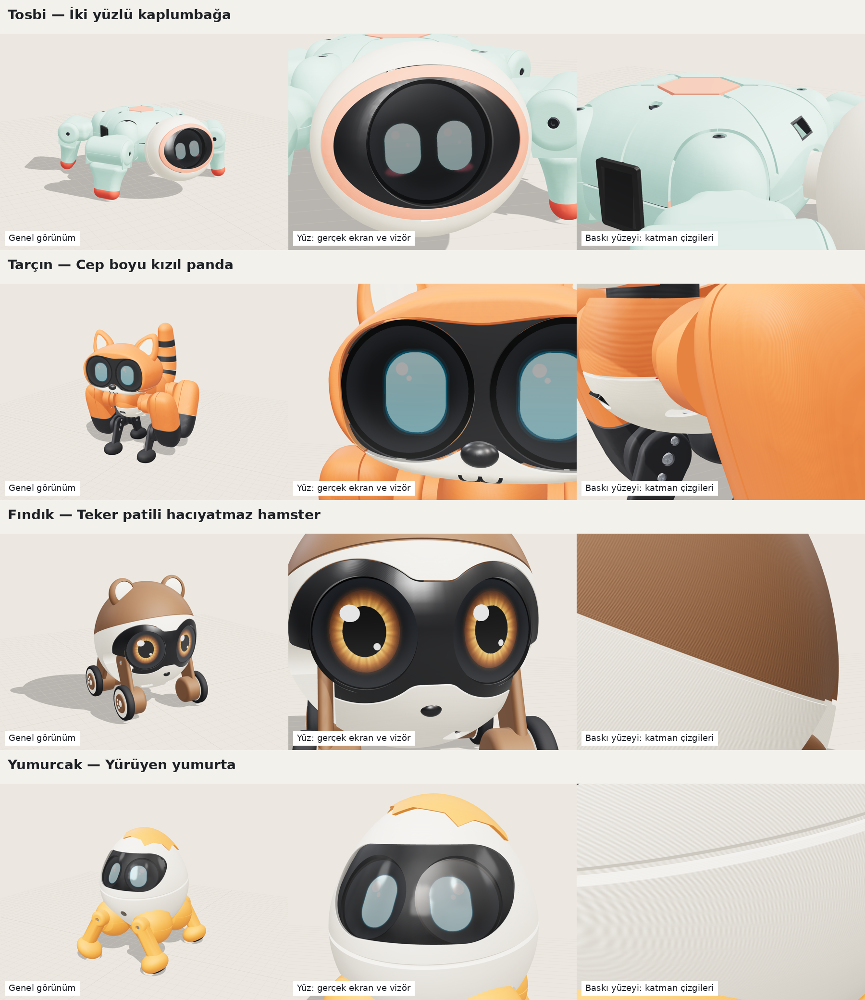

# Kıpır yeni nesil: dört masa robotu

25 Ekim 2026. "Sesame tarzında ama daha tatlı, daha gelişmiş, fiyatı çok artmadan" isteği
üzerine dört farklı robot tasarlandı. Her biri aşağıdaki adımlardan geçti; sonunda bağımsız
bir jüri dördünü karşılaştırdı.

- **Gerçek CAD:** içindeki servo, kart, pil ve ekranlar gerçek ölçüleriyle yerleştirildi.
- **Gerçekçi görünüm:** gerçek filament renkleri, 0,12-0,16 mm katman çizgileri, parça
  birleşim yerleri, vidalar ve 240×240 piksellik gerçek ekranlar.
- **Fizik simülasyonu (MuJoCo):** servolar MG90S'in gücüyle (0,2 N·m) sınırlandı; yürüme,
  dönme, düşüp kalkma gibi hareketler simüle edildi.
- **Doğrulanmış parça listesi:** her satırın fiyatı ve stoğu Türk mağazasının sayfasından
  tek tek kontrol edildi (KDV dahil).



## Nasıl incelenir?

**`robot/sunum/index.html` dosyasını tarayıcıda aç.** Çift tıklamak yeter; internet
gerekmez (~23 MB). Sayfada şunlar var:

- Dört robot gerçek boyutlarıyla bir telefonun (16 cm), 1 TL'nin ve 30 cm'lik cetvelin
  yanında duruyor.
- Fareyle ya da parmakla döndürüp yakınlaştırabilirsin.
- Hareket düğmeleri: Bekle, Yürü, Dön, Konuş (tarayıcı Türkçe ses destekliyorsa sesli),
  Sevin, Düş ve kalk, Uyu. Hareketler simülasyondan kaydedildi.
- Görünüm düğmeleri: Röntgen (içteki parçalar), Yüz yakın (ekran pikselleri), Baskı yüzeyi
  (katman çizgileri).
- Yan panelde özellikler, tek tek fiyatlı parça listesi, "gerçekte nasıl görünür" notları
  ve jüri değerlendirmesi.

## Jürinin kararı

Üç jüri dört robotu birbirinden bağımsız puanladı: görünüş, yürüme ve kalkma, maliyet ve
yapım. Toplam puan bunların ağırlıklı ortalaması (%35 / %40 / %25).

| Sıra | Robot | Görünüş | Yürüme ve kalkma | Maliyet ve yapım | Toplam | Gerçek maliyet | Sade sürüm |
|---|---|---|---|---|---|---|---|
| 1 | **Fındık**, teker patili hamster | 8 | 5 | 7,5 | **6,7** | 5.470-6.850 TL | 4.790-6.070 TL |
| 2 | **Yumurcak**, yürüyen yumurta ★ | 6 | 7 | 6,5 | **6,5** | 5.620-6.930 TL | 4.860-5.810 TL |
| 3 | **Tosbi**, iki yüzlü kaplumbağa | 4 | 8 | 6 | **6,1** | 6.050-7.400 TL | 4.850-5.680 TL |
| 4 | **Tarçın**, cep kırmızı pandası | 7 | 6 | 4,5 | **6,0** | 6.330-7.730 TL | 5.530-6.370 TL |

Maliyetlere parçalar, 3D baskı ve kargo dahil. Havya ile multimetre (gerekirse ~750-1.050 TL)
ve Claude API kredisi dahil değil.

**Öneri: Yumurcak.** Fındık puanda 0,2 önde, ama yürümüyor, tekerlekle yuvarlanıyor ve
sırtüstü düşünce kalkamıyor; "iyi yürüsün" isteğini karşılamıyor. Yumurcak gerçekten yürüyor,
simülasyonda her düşüşten sonunda kalkıyor, fikri sevimli ve sade sürümü 5 bin TL'ye yakın.
Yürümesi şart değilse en ucuz ve en kolay kurulanı Fındık.

**Puanların birbirine bu kadar yakın olmasının sebebi:** hiçbiri her konuda iyi değil.

- **Tosbi** en iyi kalkanı (156/156 düşüş) ama yengeç gibi görünüyor.
- **Tarçın** en karakterlisi ve yürüyenler arasında en hızlısı (7 cm/s), ama en pahalısı
  ve kurulumu en zor olanı.

## Dört robot kısaca

### Fındık: teker patili hamster

- **Boyut:** 96 × 93 × 117 mm, 301 g.
- **Motorlar:** 4 servo + 2 tekerlek motoru. Simülasyonda 13,8 cm/s gidiyor.
- **Görünüş:** gözlerin önünde akrilik yok, bu yüzden dördünün en parlak ve canlı gözleri onda.
- **Ses:** dördü arasında robotun üstünde mikrofon ve hoparlör olan tek tasarım.
- **Düşünce kalkma:** yana devrilince kendini toparlıyor; sırtüstü ya da yüzüstü düşerse
  yardım istiyor.

### Yumurcak: yürüyen yumurta

- **Boyut ve motorlar:** 107 × 122 × 137 mm, 346 g, 9 servo.
- **Hareket (simülasyon):** 4,5 cm/s yürüyor, saniyede 60° dönüyor.
- **Kafa:** tek servoyla eğik bir eksen üzerinde dönüyor; hem bakınıyor hem merakla başını
  yana eğiyor.
- **Düşünce kalkma:** simülasyonda üç farklı sürtünmede 60 düşüşün 60'ından sonunda kalkıyor.
  Sırtüstü düşüşte kalkması 12 saniyeyi bulabiliyor.
- **Vizör:** parlak görünmesi için evde vakumla şekillendirmek gerekiyor; basılı yedek vizör
  mat kalır.

### Tosbi: iki yüzlü kaplumbağa

- **Boyut ve motorlar:** 154 × 156 × 72 mm, 403 g, 9 servo.
- **Düşünce kalkma:** iki kabuğu aynı, bu yüzden ters düşünce öbür yüzüyle yürümeye devam
  ediyor. Simülasyonda 156 düşüşün hepsinden yaklaşık yarım saniyede kalkıyor.
- **Zayıf yanları:** yüzü küçük ve akrilik arkasında soluk görünüyor; yandaki anahtar ve
  açıkta kalan vidalar bitmemiş hissi veriyor.

### Tarçın: cep kırmızı pandası

- **Boyut ve motorlar:** 120 × 144 × 150 mm, 368 g, 10 servo.
- **Görünüş:** maskeli yüz, iki göz ekranı ve halkalı kuyruk; en tanınır hayvan karakteri.
- **Hareket:** en köpeksi yürüyüş (7 cm/s). Kuyruğu hem sevinince sallanıyor hem de düşünce
  kaldıraç oluyor.
- **Zayıf yanları:** en pahalısı. İki kart ve 10 servoyla kurulumu en zor olanı. Pil
  zorlandığında kalkma başarısı düşüyor.

Sesame (olduğu gibi ve geliştirilmiş hâli) ve StackChan'la aynı ölçütlerle karşılaştırma:
[SESAME_STACKCHAN.md](SESAME_STACKCHAN.md). Sonuç değişmedi: yürümesi şartsa Yumurcak.

## Gerçekte görselden farklı olacaklar

- **Renkler:** gerçek baskıda turuncular görseldekinden daha canlı ve doygun çıkar.
  Fındık'ın karamel rengi Türkiye'de bulunamazsa daha kahverengi bir ton kullanılır.
- **Parlak vizörler:** FDM baskıdan parlak çıkmaz. Zımpara ve vernik ya da vakumla
  şekillendirme gerekir; yapılmazsa mat ve katmanlı görünür.
- **Ekranlar:** füme akrilik arkasındaki ekranlar daha soluk, griye çalan görünür. Siyah
  ekran, aydınlık bir odada koyu gri bir daire gibi seçilir.
- **Simülasyon:** dört robotun hiçbiri henüz gerçek donanımda denenmedi. Simülasyonda pil
  voltajının düşmesi modellenmedi. Gerçek yürüyüş biraz daha yavaş olacak, kalkma hareketi
  de ince ayar isteyecek.

## Sonraki adım

1. Robotu seç.
2. Seçilen robotun CAD'ini baskıya hazırla: toleranslar, servo yuvaları, stüdyoya gidecek
   STL'ler. Önce bir bacak ve kafadan deneme baskısı yap.
3. Parçaları sipariş et. Doğrulanmış listeler `yeni_nesil/<robot>/bom.json` içinde.
4. Firmware'i yaz:
   - simülasyondaki yürüyüş ve kalkma hareketleri
   - göz ifadeleri
   - düşme algılama
   - Claude'a HTTPS istemcisi; API anahtarı robotun kodunda olmayacak

## Klasörler

```
robot/
├── sunum/index.html         tek dosyalık interaktif karşılaştırma (çift tıkla aç)
├── yeni_nesil/
│   ├── a_tosbi/  b_tarcin/  c_findik/  d_yumurcak/
│   │   ├── concept.md       tasarım gerekçesi, hesaplar
│   │   ├── NOTES.md         gerçekçilik ve simülasyon notları, belirsizlikler
│   │   ├── bom.json         doğrulanmış parça listesi (URL, stok, tarih)
│   │   ├── manifest.json    eklemler, malzemeler, ekranlar, özellikler
│   │   ├── cad/             build123d modeli ve paketleme betikleri
│   │   ├── sim/             MuJoCo modeli, yürüme/kalkma betikleri ve sonuçlar
│   │   ├── anim/ faces/     sayfadaki hareketler ve göz ifadeleri
│   │   └── gorseller/       gerçekçi görseller
│   ├── jury.json            jüri kararı
│   └── araclar/             görüntüleyici kaynak kodu ve render araçları
└── docs/YENI_NESIL.md       bu belge
```
